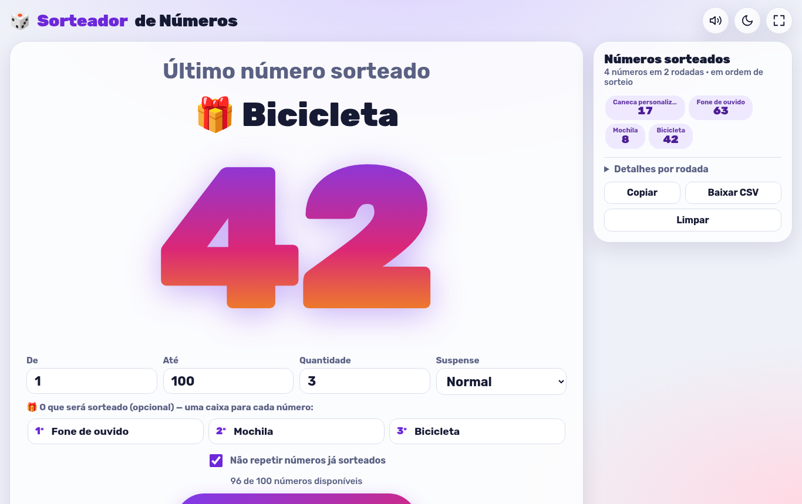
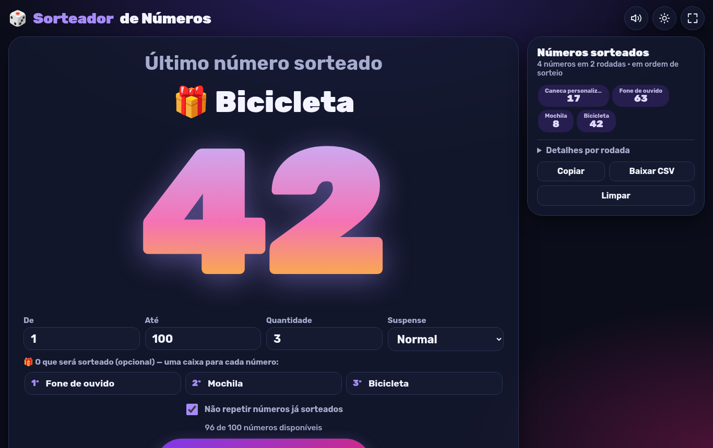
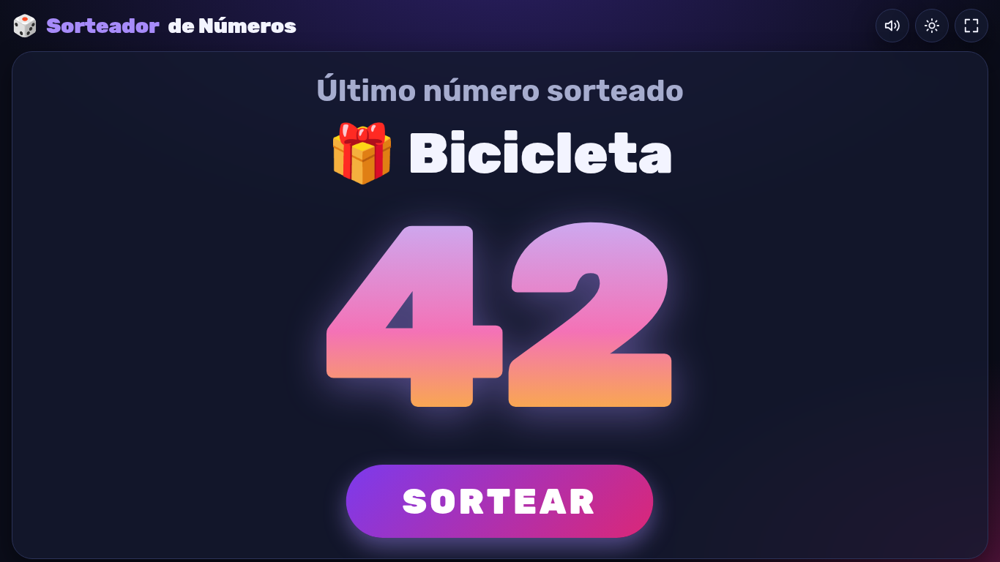
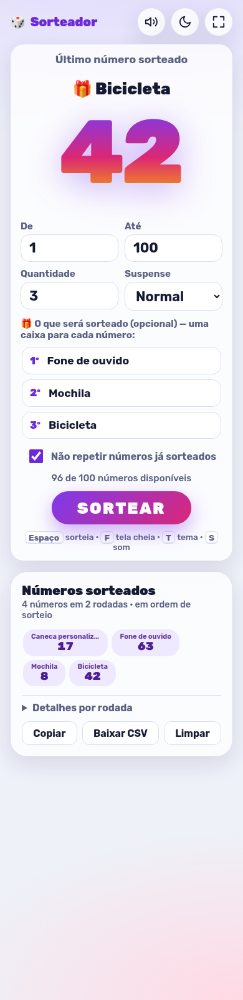

# 🎲 Sorteador de Números

Sorteador de números para usar em sala de aula, eventos e rifas. Tem animação de suspense, confetes, letras enormes para projetar em tela cheia e um campo para informar o **prêmio de cada número**.

É uma **página única** (`index.html`) feita só com HTML, CSS e JavaScript, sem bibliotecas e sem servidor. Basta abrir o arquivo no navegador.

## Funcionalidades

- **Suspense no sorteio:** os números rodam cada vez mais devagar, com frases que mudam ("Rufem os tambores…", "Quase lá…"), tremor no final, luz girando ao fundo e sons gerados pelo próprio navegador (Web Audio, sem arquivos de áudio).
- **Revelação com confetes:** o número entra crescendo, com fanfarra e chuva de confetes. Clicar no número sorteado, ou em qualquer número do histórico, solta confetes de novo.
- **Prêmios:** ao escolher a quantidade de números, aparece uma caixa de texto para cada um. O 1º número sorteado fica com o 1º prêmio, o 2º com o 2º, e assim por diante. O prêmio aparece em destaque durante o sorteio.
- **Vários números por rodada**, com a opção **"Não repetir números já sorteados"** (mostra quantos números ainda estão disponíveis).
- **Tempo de suspense ajustável:** Rápido, Normal, Longo ou Muito longo.
- **Histórico salvo no navegador** (`localStorage`): continua lá depois de fechar a página. Dá para copiar, baixar em CSV (abre no Excel), remover uma rodada ou limpar tudo.
- **Tela cheia (modo apresentação):** esconde os campos e o histórico e deixa só o prêmio, o número e o botão.
- **Tema claro e escuro**, com a escolha salva.
- **Responsivo:** funciona no celular, no notebook e no projetor.
- **Sorteio justo:** usa `crypto.getRandomValues`, o gerador aleatório criptográfico do navegador, sem favorecer nenhum número.

## Prints

| Tema escuro | Tela cheia |
|---|---|
|  |  |

## Como usar

1. Baixe o projeto e abra o `index.html` no navegador, ou coloque a pasta em um servidor web (Apache, Nginx, GitHub Pages…).
2. Informe o intervalo (**De** / **Até**), a **Quantidade** de números e, se quiser, o prêmio de cada um.
3. Clique em **SORTEAR** ou aperte `Espaço`.

### Atalhos de teclado

| Tecla | Ação |
|---|---|
| `Espaço` ou `Enter` | Sortear |
| `F` | Tela cheia |
| `T` | Alternar tema claro/escuro |
| `S` | Ligar/desligar o som |

## Onde os dados ficam salvos

Tudo fica no `localStorage` do navegador, em duas chaves:

- `sorteador.historico`: as rodadas (data e hora, intervalo, números e prêmios);
- `sorteador.config`: os campos, os prêmios digitados, o tema e o som.

O histórico vale só para o navegador e o computador em que o sorteio foi feito. Para guardar uma cópia, use **Baixar CSV**.

## Prompt usado

O projeto foi criado com o [Claude Code](https://claude.com/claude-code) a partir destes pedidos:

> Quero que crie nesta pasta um arquivo index.html ou index.php para fazer um sorteador de números. Gostaria de animação para gerar expectativa durante o sorteio e na apresentação do número sorteado. Coloque fontes bem grandes para exibir em tela cheia. Quando sortear o número ou clicar no número sorteado, mostra animação de confetes. Também preciso de opções para sortear mais números e salvar em db storage uma lista de números sorteados. Opção de tema claro e escuro e que seja responsivo.

> Vamos adicionar um campo de texto para informar o que será sorteado para cada campo. Então, quando escolher a quantidade, abrirão caixas de texto para colocar o texto do que será a premiação.

## Autor

Prof. Me. Robson Pires Borges, IFPI, Campus Floriano.
